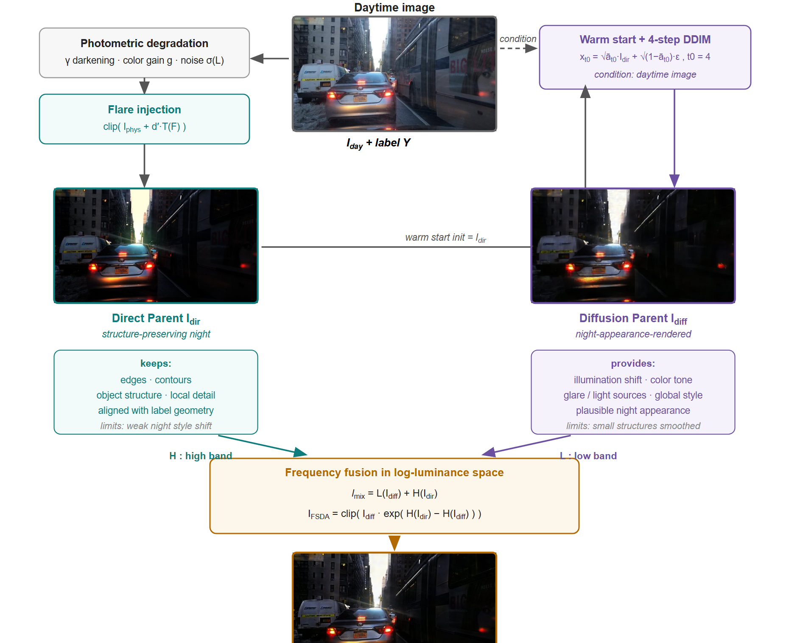
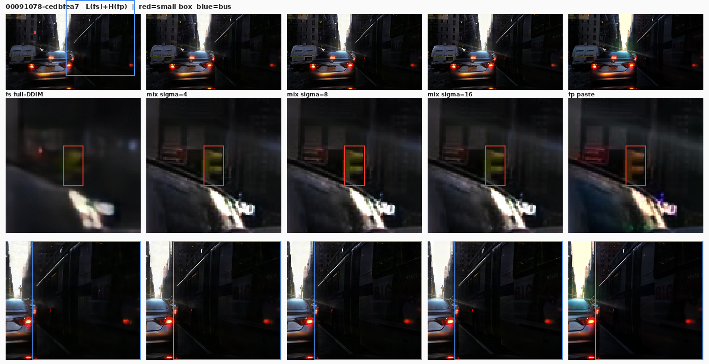

# FSDA — 面向夜间目标检测的频段交换扩散增广 (Frequency-Swapped Diffusion Augmentation)

论文《*Frequency-Swapped Diffusion Augmentation for Nighttime Object Detection*》官方代码。

FSDA 把**带标注的白天图像**变成夜间训练视图，全程不改动任何标注。方法对同一张白天图以相同的随机 draws 生成两个"亲本"，再在频率域重组：

```
白天图 ──┬─ 光度退化链 (gamma / 色彩增益 / 噪声 / 眩光)
         │        └──────────► 直接亲本 Direct Parent   (外观真实)
         └─ 同一退化链 + 4 步条件 DDIM (SDEdit 暖启动)
                  └──────────► 扩散亲本 Diffusion Parent (结构可靠)

log-luma 频段交换:   FSDA = 扩散亲本的低频段
                          + 直接亲本的高频段          (式 4-6)
```

由于两个亲本共享完全相同的几何，重组图像上的每个真值框依然有效 —— 增广在注入夜间外观多样性的同时保持了监督信息。在 BDD100K 上以固定的 YOLO11n 配方训练：向 7k 纯白天基线加入 7k 张 FSDA 视图，夜间 mAP50 从 **0.4216 提升到 0.4664 (+4.5)**。

| 亲本链路 (白天 / 直接 / 扩散 / FSDA) | 频率重组 |
|---|---|
|  |  |

## 仓库结构

```
configs/
  fsda_sigma8.yaml        主配方 (退化 + 频率重组参数)
  reverse_arm.yaml        反向频段交换消融臂
  yolo11n.yaml            检测训练配方 (所有臂固定不变)
  degradation_stats.json  标定好的退化常数 (gamma 分位格、色彩增益、
                          噪声模型 sigma(L) = a + bL)
generation/
  direct_parent.py        光度退化链 + 眩光注入           (式 1-2)
  diffusion_parent.py     SDEdit 暖启动 + 4 步 DDIM        (式 3)
  fsda_recompose.py       频率重组 + 训练集组装             (式 4-6)
  train_renderer.py       从零训练昼夜渲染器
  d2n_dataset.py          DarkDriving 成对昼夜数据集
  _sr3/                   vendored 的 SR3 式扩散最小子集 (归属说明见其
                          __init__.py)
fidelity/
  analyze_fidelity.py     监督保真度分析 (相对白天原图的框内高频 NCC /
                          边缘 NCC / log-luma 统计)
training/
  train_yolo.py           YOLO11n 微调 (公平性协议)
evaluation/
  evaluate.py             BDD 夜间测试集上的 pooled mAP50 / mAP50-95
splits/
  bdd_day_train.txt       6,999 个白天训练 stem (论文的 7k 池)
  bdd_night_test.txt      3,877 个夜间测试 stem (留出集)
examples/                 论文使用的定性图
```

## 环境安装

```bash
pip install -r requirements.txt   # torch >= 2.0, ultralytics, numpy, scipy, ...
```

`diffusion_parent.py` 与 `train_renderer.py` 需要 CUDA GPU；其余脚本纯 CPU 即可运行。

## 数据准备

| 项目 | 使用位置 | 说明 |
|---|---|---|
| BDD100K 100k 图像 + 检测标注 | 亲本生成、训练、测试 | 白天训练图取自 100k split (stem 见 `splits/bdd_day_train.txt`)；夜间测试集 = `splits/bdd_night_test.txt` 的 3,877 张；标注需转成 YOLO txt 格式 (任意标准 BDD 转换器) |
| Flare7K++ | 眩光库 (式 2) | 把 `flare_dirs` 指向三个 compound/reflective 眩光目录 |
| DarkDriving (成对昼夜图) | 渲染器训练 | 仅在从头训练渲染器时需要；9,530 对同场景图像 |
| 渲染器权重 | `diffusion_parent.py` | 预训练 EMA 权重 (150k 迭代) — 从 [Releases](../../releases) 下载后设置 `renderer_ckpt` |

然后把 `configs/fsda_sigma8.yaml` 里的占位路径改成实际路径：

```yaml
flare_dirs:  [/data/Flare7Kpp/...]
day_dir:     /data/bdd100k_day_images
labels_dir:  /data/bdd_day_labels        # YOLO 格式 txt, 同 stem
renderer_ckpt: /data/Ema_I150000.pth
```

## 快速开始 (完整流水线)

以下命令均在仓库根目录执行。

```bash
# 1) 直接亲本 — 光度退化 + 眩光 (CPU, 可分片并行)
python generation/direct_parent.py --config configs/fsda_sigma8.yaml

# 2) 扩散亲本 — 相同种子 => 每张图 gamma/噪声/眩光 draws 完全一致,
#    再加 4 步条件 DDIM (GPU)
python generation/diffusion_parent.py --config configs/fsda_sigma8.yaml

# 3) FSDA 频率重组 + YOLO 训练集组装 (CPU)
python generation/fsda_recompose.py --config configs/fsda_sigma8.yaml

# 4) 训练检测器 (配方固定; 各臂唯一变量是数据 yaml)
python training/train_yolo.py --data outputs/fsda/fsda_train.yaml --name fsda

# 5) 在留出的 BDD 夜间测试集上评测
python evaluation/evaluate.py --weights runs/ft_fsda/weights/best.pt \
    --img-dir /data/bdd100k_night/images/test \
    --labels-dir /data/bdd100k_night/labels/test
```

复现**反向频段交换消融**：复用同一对亲本，只换配置文件：

```bash
python generation/fsda_recompose.py --config configs/reverse_arm.yaml
python training/train_yolo.py --data outputs/fsda_reverse/fsda_train.yaml --name fsda_reverse
```

大规模生成可以跨机器 / 多 GPU 分片：

```bash
python generation/diffusion_parent.py --config configs/fsda_sigma8.yaml --shard 0 --nshards 4
python generation/diffusion_parent.py --config configs/fsda_sigma8.yaml --shard 1 --nshards 4
# ... (direct_parent.py 必须用完全相同的分片拓扑, 才能保证每张图的
#      gamma/噪声/眩光 draws 保持配对)
```

## 主要结果 (BDD100K 夜间测试集, 3,877 张, YOLO11n)

| 训练集 (7k 白天 + 7k 增广) | mAP50 | mAP50-95 |
|---|---|---|
| 纯白天基线 (无增广)                   | 0.4216 | — |
| + ODGEN (最强外部基线)                | 0.4505 | — |
| + 直接亲本 (ours)                     | 0.4491 | 0.2584 |
| + 扩散亲本 (ours)                     | 0.4510 | 0.2619 |
| **+ FSDA (ours)**                     | **0.4664** | **0.2670** |

多种子 (seed 42/43/44, 均值±标准差)：FSDA **0.4631 ± 0.0087**，纯白天基线
0.4234 ± 0.0096 —— +4 个百分点的增益远超种子间噪声。同一组检查点零样本迁移
(不做目标域训练)：ACDC-night +0.90、NightCity +0.89、Dark Zurich +0.29 AP50
(相对纯白天基线)。完整对比表、真夜数据预算-价值研究、监督保真度分析
(`fidelity/analyze_fidelity.py`) 见论文。

## 从头训练渲染器

发布的渲染器权重由以下命令产出：

```bash
python generation/train_renderer.py --dd-dir /data/DarkDriving_720p \
    --iters 150000 --batch 16 --crop 128 --out outputs/renderer
# 把 outputs/renderer/Ema_I150000.pth 用作 `renderer_ckpt`
```

## 可复现性说明

- **RNG 纪律** — `np.random` (seed + shard) 只被 gamma 与噪声 draws 消耗；
  眩光 draws 走独立的 `default_rng` 流；DDIM 暖启动噪声用
  `torch.manual_seed(seed + shard)`。因此两个亲本脚本对每张图产生*完全一致*
  的光度 draws —— 这正是配对构造保持标注有效的原因。
- **逐位一致** — 全部生成侧数学 (退化常数、眩光仿射画布、DDIM 循环、频段
  交换) 与论文实验运行所用代码完全相同。
- **验证集** — 组装出的数据 yaml 为方便起见把 `val` 设为训练集本身；论文
  运行是在一份内部验证集上选 `best.pt`。最终指标一律由
  `evaluation/evaluate.py` 在留出的夜间测试集上计算, 此差异只影响中间
  检查点选择。

## 许可证与引用

代码以 MIT License 发布 (见 `LICENSE`)。各数据集与 vendored 的 `_sr3`
子集保留其原有许可 / 归属。

论文在审中；录用后补充引用条目。

## 致谢

- [ReDDiT](https://arxiv.org/abs/2410.12346) (CVPR 2025) 与 SR3 —
  `generation/_sr3` 中 vendored 的扩散架构。
- Flare7K++ — 镜头眩光源库。
- DarkDriving — 用于渲染器训练的成对昼夜驾驶图像。
- BDD100K — 白天训练图像与夜间测试协议。
- [Ultralytics YOLO11](https://github.com/ultralytics/ultralytics)。